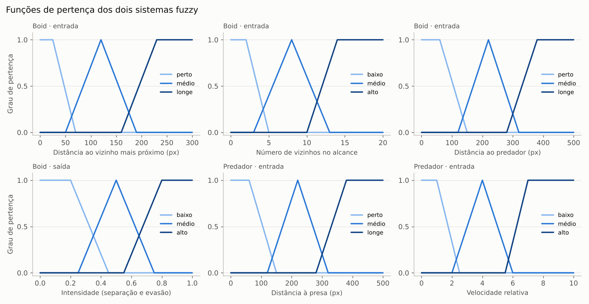

# Lógica fuzzy para um bando com predador

Projeto da unidade curricular de Inteligência Artificial (Licenciatura em Matemática Aplicada e Tecnologias Digitais, Iscte).

Numa simulação de *boids*, os pássaros movem-se em bando e um predador tenta apanhá-los. Este módulo decide, com lógica fuzzy, com que força cada boid se afasta dos vizinhos e foge do predador, e com que agressividade o predador persegue a presa. Foi feito em Python com scikit-fuzzy, e os vetores de movimento usam pygame.



## Como funciona

O processo tem quatro passos: fuzzificação, regras SE-ENTÃO, inferência e defuzzificação. As funções de pertença são trapezoidais para os extremos (perto e longe) e triangulares para as transições, o que evita movimentos bruscos.

**Boid**
- **Entradas:** a distância ao vizinho mais próximo, o número de vizinhos no alcance visual e a distância ao predador.
- **Saídas:** a intensidade da separação e a intensidade da evasão, ambas entre 0 e 1.
- **Regras (7):**
  - quanto mais perto o vizinho, mais forte a separação, e um grupo muito denso reforça-a;
  - quanto mais perto o predador, mais forte a evasão.
- **Força final:** a direção vem da geometria (o vetor unitário que aponta para longe do vizinho ou do predador) e a intensidade vem do sistema fuzzy. A força cresce de forma não linear quando há muita proximidade e fica limitada a um valor máximo por frame, para o movimento se manter suave.

**Predador**
- **Escolha do alvo:** o boid mais próximo dentro do alcance de caça.
- **Entradas:** a distância à presa e a velocidade relativa.
- **Saídas:** o fator de velocidade e o fator de viragem.
- **Movimento:** segue o modelo clássico de *steering*, em que a força é a velocidade desejada menos a velocidade atual. Essa força é limitada por uma força máxima que cresce com o fator de viragem.

## Utilização

O ficheiro `fuzzy.py` liga-se ao motor de simulação usado na UC, que não está incluído neste repositório. Cada sistema expõe `calculate_fuzzy()`, que lê o ambiente e corre a inferência, e `compute()`, que devolve o vetor de força para esse frame.

```
pip install scikit-fuzzy numpy pygame
```
## Autoras 

Inês Ferreira e Madalena Brás